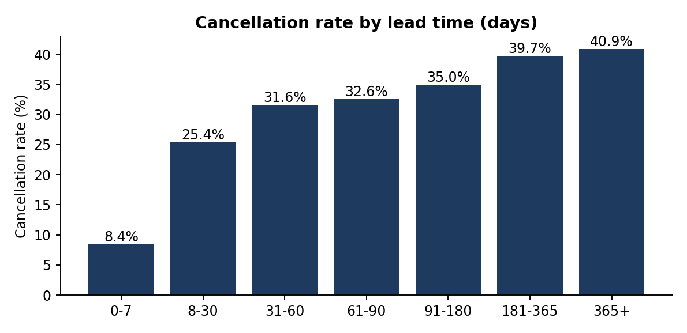
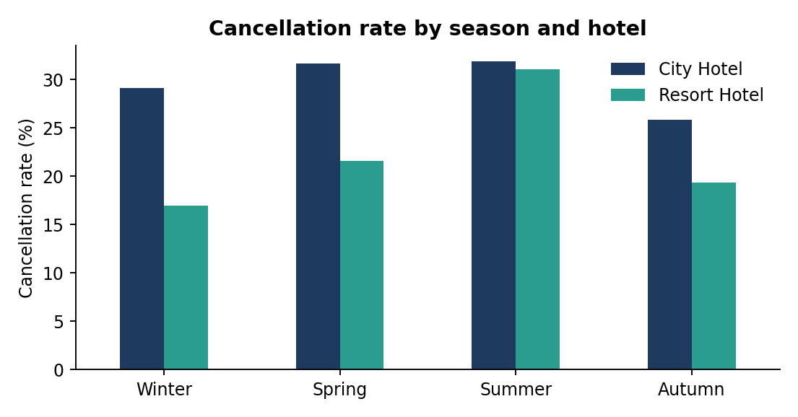

# Hotel Harmony: Hotel Booking Analysis

An exploratory data analysis of 119,390 hotel bookings (a city hotel and a resort hotel in Portugal, 2015 to 2017). I wanted to find out **when guests book, who they are, and why so many bookings get cancelled**.

This is a learning project. I worked through a 25-question case study (basic, medium and advanced) and wrote down what I found, what surprised me and what I'm not sure about.

**Tools:** Python, pandas, matplotlib, seaborn, scikit-learn

## What I found

| Finding | Detail |
|---|---|
| **1 in 4 bookings is cancelled** | 27.5% overall. City Hotel 30.0%, Resort Hotel 23.5% |
| **Booking early = cancelling more** | 8% cancelled when booked within a week, about 40% when booked a year or more ahead |
| **Online travel agents are risky** | 35% of their bookings are cancelled, against 15% for direct bookings |
| **Summer is busiest and riskiest** | August earns the most, and summer has the highest cancellation rate (31.6%) |
| **Prices went up** | Average daily rate rose from 92 (2015) to 119 (2017), though the months covered differ by year |
| **Few repeat guests** | Only 3.9% of bookings, and they stay about half as long (1.9 vs 3.7 nights) |





## What I'd suggest to the hotel

1. Ask for a deposit or send a reminder for bookings made far in advance.
2. Push direct bookings, which cancel less and avoid agent commission.
3. Use stricter cancellation rules in summer, especially at the Resort.
4. Look at a loyalty offer for repeat guests.

## Things I had to decide (and why)

- **Duplicates:** 31,994 rows (27%) were exact copies. There is no booking ID, so I can't be fully sure, but I removed them so stays aren't counted twice. This changes the cancellation rate from 37% to 27.5%.
- **Missing values:** a blank `agent` or `company` most likely means none was involved, so I filled with 0.
- **Revenue:** the case study suggests summing ADR, but ADR is a per-night rate, so I used ADR x nights and counted only stays that were not cancelled.
- **Lead time vs cancellation:** a scatter plot of a 0/1 column is unreadable, so I grouped lead time into bands instead.

## What I'm not sure about

- **The cancellation model is weak at prediction.** It is 74% accurate, but 72.5% of bookings aren't cancelled anyway, and it only catches 16% of real cancellations. It helps explain *drivers*, not predict.
- **"Non Refund" deposits are cancelled 94.7% of the time.** That is the opposite of what I'd expect, so I think there is a data issue. I'd ask the hotel what it means.
- **Special requests are not satisfaction.** One question asks about satisfaction, but the data has no satisfaction score.
- **Uneven dates.** July and August have 3 years of data and other months have 2, which affects month and year comparisons.

## What I learned

- Cleaning decisions (like removing duplicates) can change the headline numbers a lot, so I should always write them down.
- Accuracy can be misleading when one outcome is much more common than the other.
- A correlation of 0.18 can look weak but hide a clear pattern once you group the data.

## Next steps

- Try a random forest or gradient boosting model with class weights.
- Compare ADR for the same months across years.
- Build a Power BI dashboard from the results.

## Project structure

```
hotel-booking-eda/
├── README.md
├── requirements.txt
├── data/            <- put hotel_bookings.csv here (see data/README.md)
├── notebook/
│   └── hotel_booking_eda.ipynb   <- full analysis, all 25 questions
├── docs/
│   ├── case_study.md             <- problem, data dictionary, questions
│   ├── answers.md                <- short answers to all 25 questions
│   └── resources.md              <- things I used and want to read next
└── images/
```

## How to run

```bash
pip install -r requirements.txt
# download hotel_bookings.csv into data/
jupyter notebook notebook/hotel_booking_eda.ipynb
```

## Credits

Dataset: Antonio, Almeida & Nunes (2019), *Hotel booking demand datasets*, Data in Brief 22, via [Kaggle](https://www.kaggle.com/jessemostipak/hotel-booking-demand). Case study brief: EDA-02 Hotel Operations Analysis.
